# FUERA DE TEMPORADA

## Dispositivos impenitentes: la reincidencia como nuevo pecado original

Proyecto web compuesto por cinco páginas para dispositivos móviles **Apple** que, si bien siguen siendo funcionales, la **obsolescencia programada** los desplazó de su ciclo de uso. Cada página trabaja con tres estados: una imagen splash que insiste y llama la atención, una reacción física/sonora simulada y una última pantalla que devuelve el dispositivo al campo social de los objetos descartados, donados o recuperados.

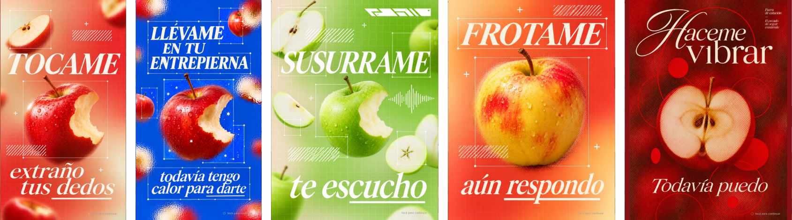

*Las cinco pantallas splash del proyecto, correspondientes al iPhone 15, iPhone 11, iPhone 4, iPad mini e iPhone 5.*

Tocar la pantalla de estos dispositivos Apple (manzanas), conduce a una pantalla de transición que exclama ***"¡Todavía no acabé!"*** mientras se sacude y finalmente despliega una nueva pantalla con una frase y un breve texto acerca de posibles usos de teléfonos descartadas o simplemente designados obsoletos.

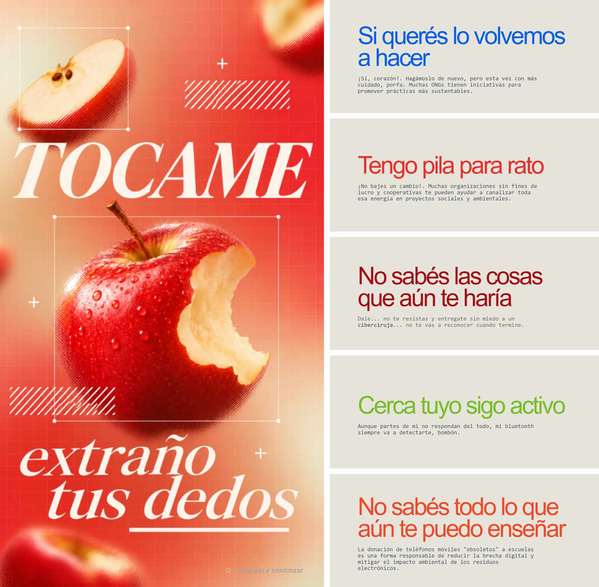

*Frases principales y textos secundarios de los estados 3 de las cinco páginas, organizados por color y dispositivo.*

Las imágenes de cada splash están separadas en dos capas: un fondo visual y una capa tipográfica transparente. Esto permite animar la entrada y salida de los textos sin deformar ni alterar la composición original. En el estado 3, tanto el enlace superior como la frase principal permiten volver al estado 1.

## Páginas y puertos

| Carpeta | Dispositivo | Puerto |
| --- | --- | ---: |
| `iphone4` | iPhone 4 | 8804 |
| `iphone5` | iPhone 5 | 8805 |
| `iphone11` | iPhone 11 | 8811 |
| `iphone15` | iPhone 15 | 8815 |
| `ipadMini` | iPad mini | 8888 |
| `basic` | iPad mini / Safari antiguo | 8899 |

## iPhone 4 — SUSÚRRAME (te escucho)

**Idea:** un teléfono como resto de una voz: escucha, conserva y vuelve a poner en circulación una intimidad.

**Estado 1 — Splash:** aparece el póster verde con manzanas, la palabra `SUSÚRRAME` y la frase `te escucho`. El fondo se sacude periódicamente mientras la tipografía entra y sale del cuadro.

**Estado 2 — Reacción:** al tocar cualquier zona de la pantalla aparece `... todavía no acabé...`, acompañado por sacudida visual, cambio al rojo y un sonido breve. La vibración física del dispositivo no se afirma: se simula mediante imagen y audio.

**Estado 3 — Dato:** aparece en grande `Cerca tuyo sigo activo`, seguido por `Aunque partes de mi no respondan del todo, mi bluetooth siempre va a detectarte, bombón.`

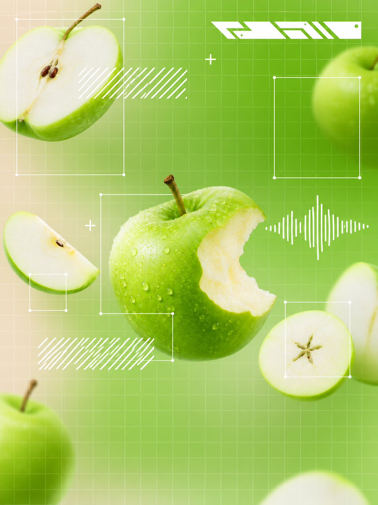


## iPhone 5 — HACEME VIBRAR (todavía puedo)

**Idea:** un dispositivo abandonado insiste en demostrar que todavía puede responder.

**Estado 1 — Splash:** la manzana roja y partida sostiene las frases `Haceme vibrar` y `Todavía puedo`. El texto entra desde afuera, se mantiene, sale del cuadro y vuelve a entrar; el fondo tiene sacudidas independientes.

**Estado 2 — Reacción:** al tocar cualquier punto aparece `... todavía no acabé...` sobre un rojo carmín. La pantalla se sacude, suena y permanece en este estado antes de pasar al informe.

**Estado 3 — Dato:** aparece en grande `No sabés las cosas que aún te haría`, seguido por `Dale... no te resistas y entregate sin miedo a un ciberciruja... no te vas a reconocer cuando termine.`, con `ciberciruja` en negrita.

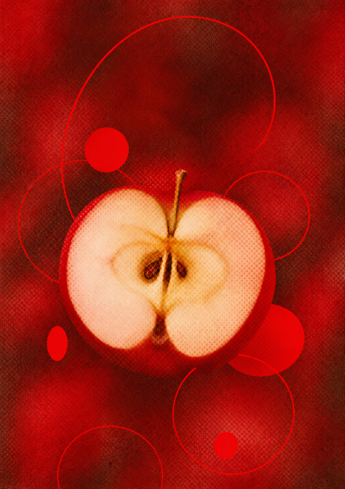


## iPhone 11 — LLEVAME EN TU ENTREPIERNA (todavía tengo calor para darte)

**Idea:** el teléfono aparece como un objeto de contacto, temperatura y circulación corporal.

**Estado 1 — Splash:** el póster azul de manzanas jugosas presenta `LLEVAME EN TU ENTREPIERNA` y `todavía tengo calor para darte`. El fondo se sacude con mayor intensidad y la tipografía se mueve en una capa propia.

**Estado 2 — Reacción:** al tocar la pantalla aparece `... todavía no acabé...`, con sacudida, sonido y un azul eléctrico tomado del póster.

**Estado 3 — Dato:** aparece en grande `Tengo pila para rato`, seguido por `¡No bajes un cambio!. Muchas organizaciones sin fines de lucro y cooperativas te pueden ayudar a canalizar toda esa energía en proyectos sociales y ambientales.`

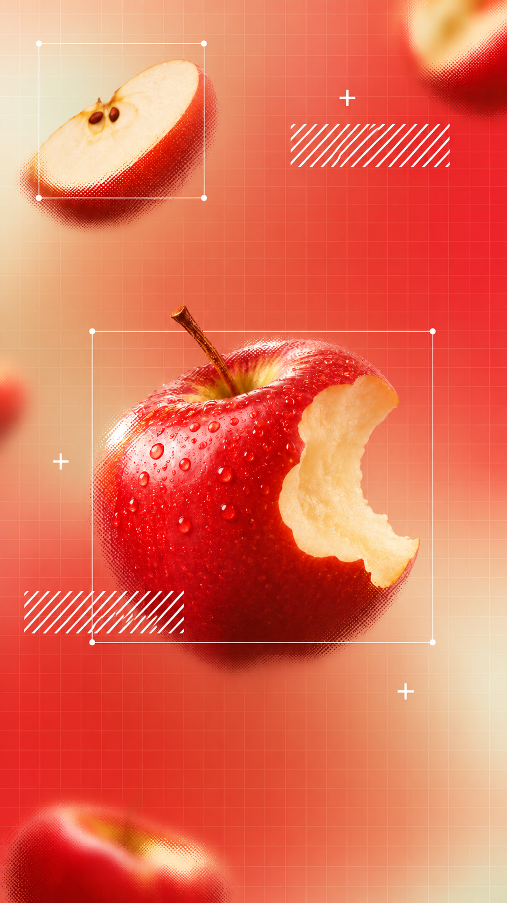


## iPhone 15 — TOCAME (extraño tus dedos)

**Idea:** la pantalla reclama el contacto perdido y convierte el gesto táctil en una reincidencia.

**Estado 1 — Splash:** el póster rojo de manzana mordida muestra `TOCAME` y `extraño tus dedos`. El fondo se sacude de forma más rápida e intensa, sin desplazar los textos.

**Estado 2 — Reacción:** al tocar cualquier lugar aparece `... todavía no acabé...`; la pantalla se sacude como la del iPhone 5, se vuelve azul y reproduce un sonido breve.

**Estado 3 — Dato:** aparece en grande `Si querés lo volvemos a hacer`, seguido por `¡Sí, corazón!. Hagámoslo de nuevo, pero esta vez con más cuidado, porfa. Muchas ONGs tienen iniciativas para promover prácticas más sustentables.`

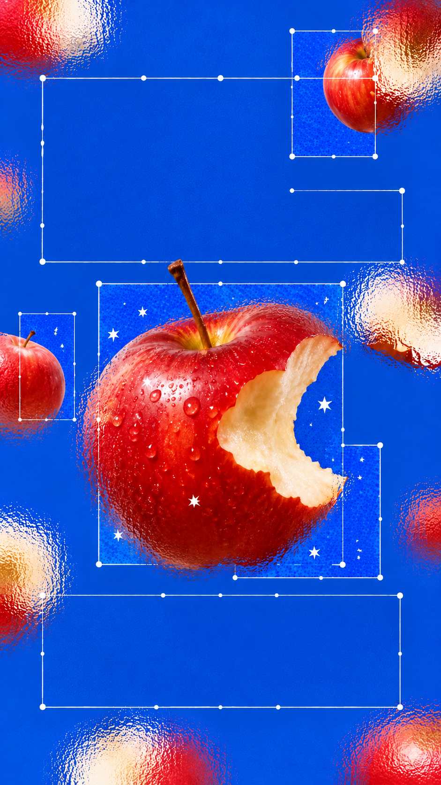


## iPad mini — FROTAME (aún respondo)

**Idea:** un aparato que todavía responde al contacto, aunque su lugar en el circuito tecnológico ya parezca agotado.

**Estado 1 — Splash:** el póster naranja muestra `FROTAME` y `aún respondo`. El fondo se sacude con intensidad y el texto entra y sale periódicamente como una insistencia táctil.

**Estado 2 — Reacción:** al tocar cualquier zona aparece `... todavía no acabé...`, con pantalla roja, sonido y sacudida visual.

**Estado 3 — Dato:** aparece en grande `No sabés todo lo que aún te puedo enseñar`, seguido por `La donación de teléfonos móviles "obsoletos" a escuelas es una forma responsable de reducir la brecha digital y mitigar el impacto ambiental de los residuos electrónicos.`

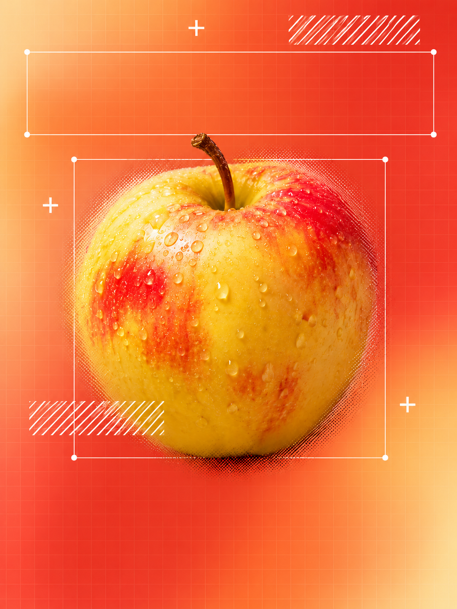


### Versión básica para Safari antiguo

`basic` conserva los tres estados y las dos capas visuales, pero elimina animaciones, transiciones, etiquetas HTML5 y propiedades CSS modernas. Usa el puerto `8899` y está pensada para el iPad mini antiguo.

## Limitación de la háptica

Safari en iOS no expone una vibración física confiable desde una página web mediante `navigator.vibrate`. Las piezas simulan la respuesta háptica con movimiento visual, cambios de color y sonido generado después del toque.

## Levantar todos los sitios

Desde esta carpeta:

```bash
bash run-all.sh
```

El script muestra una leyenda por cada sitio iniciado, con su dispositivo y puerto. Para acceder desde otro dispositivo de la red local, reemplazar `127.0.0.1` por la IP LAN del equipo que ejecuta los servidores.

También se puede indicar otro ejecutable de Python:

```bash
PYTHON_BIN=python bash run-all.sh
```

Cada página conserva sus propios archivos y recursos.
